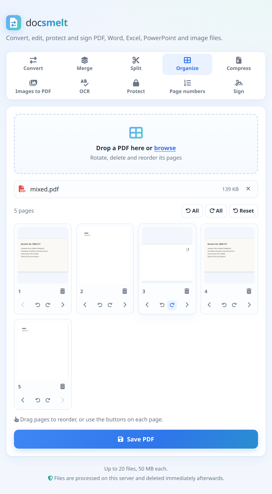
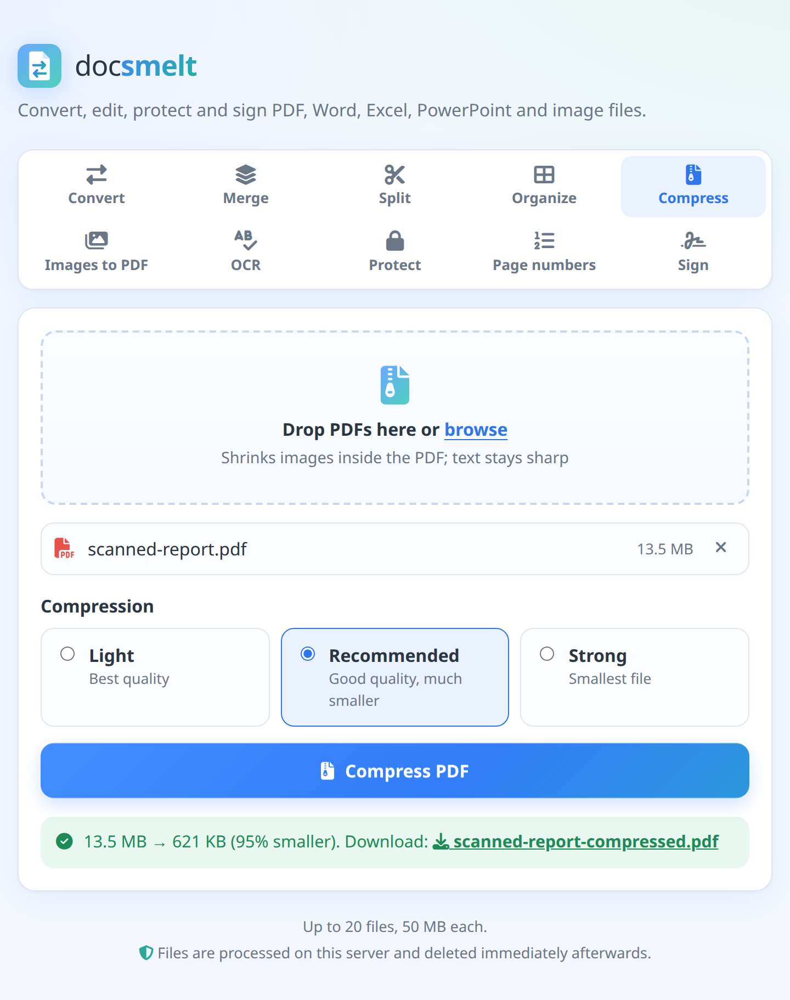
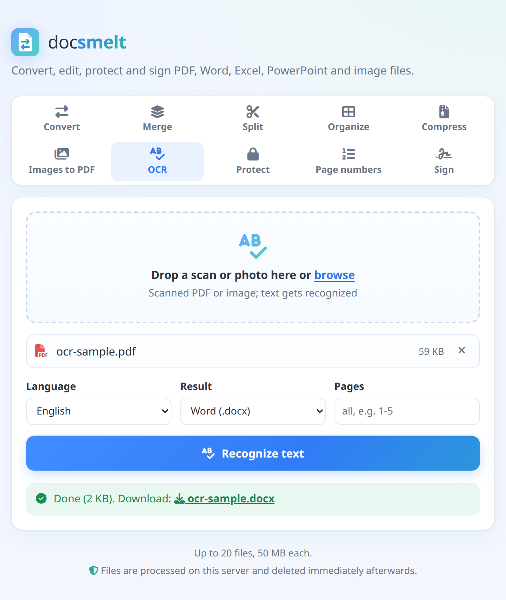
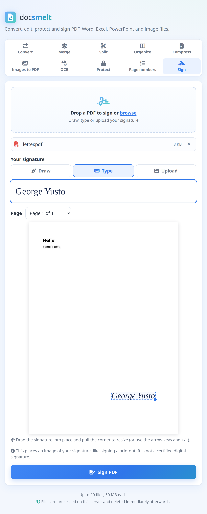
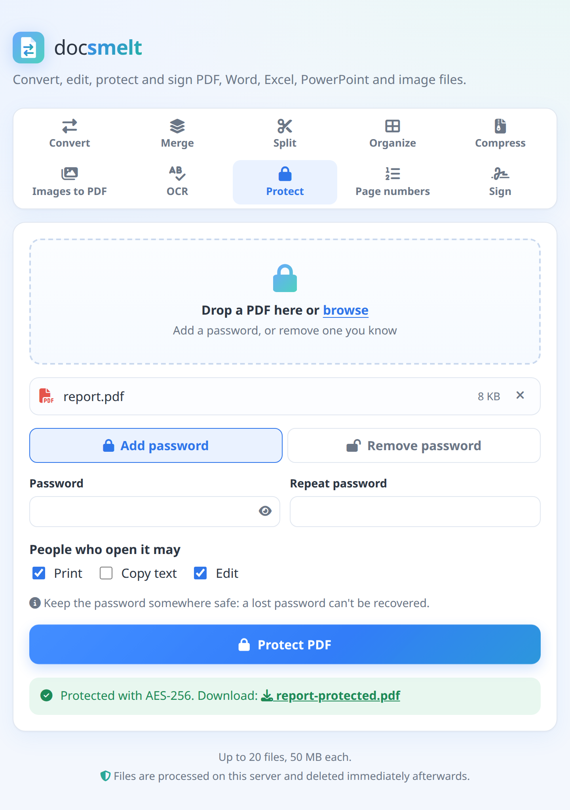
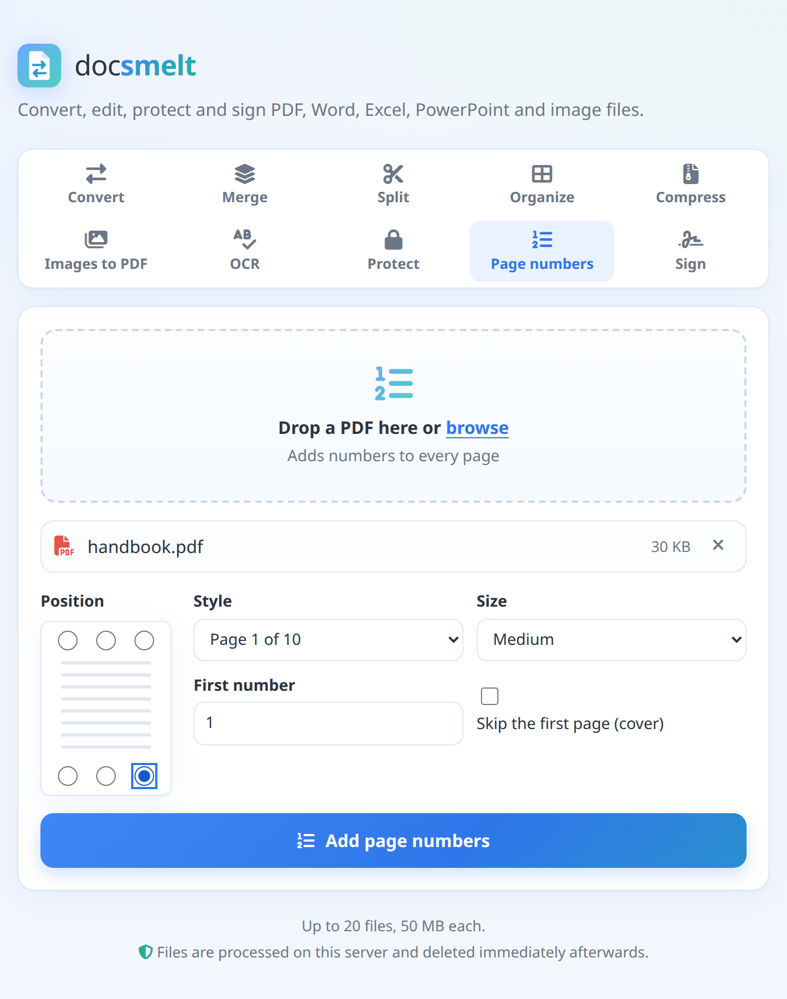

<h1 align="center">
  <picture>
    <source media="(prefers-color-scheme: dark)" srcset="docs/images/logo-dark.png">
    
  </picture>
</h1>

<p align="center">
  Convert, merge, split, organize, compress, OCR, protect, number and sign<br>
  PDF, Word, Excel, PowerPoint and image files,<br>
  from a web page, the command line or Docker.<br>
  Object-oriented Java 21. Self-hosted: files never leave your server.
</p>

<p align="center">
  
</p>

## Features

- **Convert** between `pdf`, `docx`, `xlsx`, `pptx`, `txt`, `png`, `jpg/jpeg`, `bmp` and `gif` (plus reading legacy `xls`), one file or whole folders
- **Excel**: sheets become real tables (bordered, header repeated on each page, landscape when wide); tables from Word become real Excel cells with numbers kept as numbers
- **PowerPoint**: slides become PDF pages or images that look like the slides; documents and PDFs become slides
- **Merge** any mix of PDFs, Word files, text and images into one PDF
- **Split** a PDF every N pages or by custom ranges
- **Organize** pages visually: rotate, delete and drag to reorder
- **Compress** PDFs by shrinking their images (a 13.5 MB scan became 621 KB in testing)
- **Images to PDF**: photos or scans, one per page; JPEGs keep their original quality
- **OCR** with Tesseract: scans and photos become searchable PDFs, Word or text (English, Swahili, French in Docker)
- **Protect**: add an AES-256 password (optionally blocking printing or copying), or remove a password you know
- **Page numbers**: six positions, styles like "Page 1 of 10", skip the cover, any start number
- **Sign**: draw, type or upload a signature and drag it into place on the page
- **Unicode PDFs**: Latin, Greek, Cyrillic built in; Chinese, Japanese, Korean via a fallback font
- **Web UI** with drag and drop, plus a REST API, a CLI and a Docker image

<table>
  <tr>
    <td align="center"><br><b>Organize</b>: rotate, delete, drag</td>
    <td align="center"><br><b>Compress</b>: 13.5 MB → 621 KB</td>
    <td align="center"><br><b>OCR</b>: scans to text</td>
  </tr>
  <tr>
    <td align="center"><br><b>Merge</b>: reorder, then combine</td>
    <td align="center"><br><b>Split</b>: every N pages or ranges</td>
    <td align="center"><br><b>Mobile</b>-friendly</td>
  </tr>
  <tr>
    <td align="center"><br><b>Sign</b>: draw, type or upload</td>
    <td align="center"><br><b>Protect</b>: AES-256 password</td>
    <td align="center"><br><b>Page numbers</b></td>
  </tr>
</table>

## Usage

```bash
mvn package                                    # builds target/docsmelt.jar (runs tests)
alias docsmelt='java -jar target/docsmelt.jar'

# Convert
docsmelt report.docx report.pdf
docsmelt slides.pdf page.png --dpi 300          # multi-page → page-1.png, page-2.png, ...
docsmelt scan.pdf cover.jpg --pages 1 -q 80     # page selection, JPEG quality

# Batch (files and folders; folder inputs skip files of other types)
docsmelt --to pdf docs/ notes.txt -o out/ -r -j 4

# PDF tools
docsmelt merge cover.jpg report.docx appendix.pdf -o book.pdf   # non-PDFs converted automatically
docsmelt split book.pdf                         # one file per page
docsmelt split book.pdf --every 10 -o parts/
docsmelt split book.pdf --ranges 1-3,4-9,10-    # one file per range
docsmelt split book.pdf --ranges 5-7            # extract pages

# Pages: rotate, delete, reorder (page numbers refer to the original)
docsmelt pages scan.pdf --rotate 90 -o fixed.pdf          # every page
docsmelt pages scan.pdf --rotate 180:2,4 -o fixed.pdf     # pages 2 and 4
docsmelt pages report.pdf --delete 3,7-9 --order 5,1-4 -o edited.pdf

# Images to PDF (a4 | letter | fit)
docsmelt images scan1.jpg scan2.jpg scan3.jpg -o scans.pdf
docsmelt images photos/*.png -o album.pdf --page-size fit --margin 0

# Compress (low | medium | high)
docsmelt compress big.pdf -o small.pdf --level high

# OCR (needs Tesseract; output type follows the extension)
docsmelt ocr scan.pdf -o searchable.pdf
docsmelt ocr receipt.jpg -o receipt.txt
docsmelt ocr barua.pdf -o barua.docx --lang swa+eng
docsmelt ocr --list-langs

# Excel and PowerPoint are ordinary conversions
docsmelt sales.xlsx sales.pdf
docsmelt deck.pptx slide.png --dpi 200          # one image per slide
docsmelt report.docx report.pptx

# Password (leave out the value to be prompted, so it's not in your shell history)
docsmelt protect contract.pdf -o locked.pdf --password --no-copy
docsmelt unlock locked.pdf -o open.pdf --password

# Page numbers ({n} and {total})
docsmelt number thesis.pdf -o numbered.pdf --format "Page {n} of {total}" --position bottom-right --pages 2- --start 1

# Sign (visual signature; position as fractions of the page, default bottom right of the last page)
docsmelt sign contract.pdf --signature sig.png -o signed.pdf --page 2 --x 0.6 --y 0.8 --width 0.3

docsmelt --help          # and: docsmelt <command> --help
```

Exit codes: `0` ok, `1` conversion failed, `2` bad usage.

### Unicode / fonts

PDF output embeds DejaVu Sans (Latin, Greek, Cyrillic and many symbols). For
other scripts such as Chinese, Japanese or Korean, add a TrueType fallback font:

```bash
docsmelt notes.txt notes.pdf --font /usr/share/fonts/truetype/droid/DroidSansFallbackFull.ttf
# or once for all runs:
export DOCSMELT_FONTS=/path/a.ttf:/path/b.ttf
```

Only `.ttf` fonts with TrueType outlines work (PDFBox limitation; `.ttc`/CFF `.otf` don't).
Characters no font covers (e.g. colour emoji) become `?`.

## Web UI

```bash
docsmelt serve                    # http://127.0.0.1:8080 (this computer only)
docsmelt serve --host 0.0.0.0     # reachable from your network
```

A single page with ten tools (Convert, Merge, Split, Organize, Compress,
Images to PDF, OCR, Protect, Page numbers, Sign), drag and drop, and upload
progress. Passwords are never logged. Icons come from Font Awesome, served from the jar (no CDN).
Uploads are processed in a private temp folder that is deleted as soon as the
response is sent.

Limits (all configurable on `serve`): `--max-upload-mb 50`, `--max-files 20`,
`--rate-limit 30` requests/minute per IP. Concurrent conversions are capped at
the number of CPU cores.

API (multipart/form-data, field `files`):

| Endpoint | Fields | Returns |
|---|---|---|
| `POST /api/convert` | `files` (1+), `to`, `pages?`, `dpi?`, `quality?` | the file, or a `.zip` if several |
| `POST /api/merge` | `files` (2+, in order) | `merged.pdf` |
| `POST /api/split` | `files` (1 PDF), `every?` or `ranges?` | a `.zip` of the parts |
| `POST /api/preview` | `files` (1 PDF) | JSON page thumbnails |
| `POST /api/organize` | `files` (1 PDF), `order` (`3,1,2`), `rotate?` (`1:90,3:270`) | `<name>-organized.pdf` |
| `POST /api/compress` | `files` (PDFs), `level?` (`low`/`medium`/`high`) | `<name>-compressed.pdf`, or a `.zip` |
| `POST /api/images-to-pdf` | `files` (images, in order), `pageSize?`, `margin?` (`none`/`small`/`normal`) | one PDF |
| `POST /api/ocr` | `files` (1 PDF/image), `lang?`, `output?` (`pdf`/`txt`/`docx`), `pages?` | the result (max 30 pages) |
| `POST /api/protect` | `files` (1 PDF), `password`, `allowPrint?`, `allowCopy?`, `allowEdit?` | `<name>-protected.pdf` |
| `POST /api/unlock` | `files` (1 PDF), `password` | `<name>-unlocked.pdf` |
| `POST /api/number` | `files` (1 PDF), `position?`, `format?`, `start?`, `pages?`, `size?` | `<name>-numbered.pdf` |
| `POST /api/sign` | `files` (PDF + signature image), `page?` (0 = last), `x`, `y`, `width` (fractions) | `<name>-signed.pdf` |
| `GET /api/formats` | | formats, limits and OCR languages as JSON |

Errors are JSON: `{"error": "..."}` with status 400, 429 or 503.

## Docker

```bash
docker compose up -d             # web UI on http://localhost:8080
DOCSMELT_PORT=8090 docker compose up -d   # if 8080 is taken

# or the CLI, without the web UI:
docker build -t docsmelt .
docker run --rm -u "$(id -u):$(id -g)" -v "$PWD:/work" docsmelt report.docx report.pdf
docker run --rm -u "$(id -u):$(id -g)" -v "$PWD:/work" docsmelt merge a.pdf b.pdf -o all.pdf
```

The image runs the test suite during build and ships with Tesseract OCR
(English, Swahili, French) and a CJK fallback font preconfigured. Choose other
OCR languages at build time: `docker build --build-arg OCR_LANGS="eng swa ara" .` With no arguments it starts the web UI; any arguments run the
CLI instead (paths relative to the mounted `/work`).

## Design

```
Reader ──► Document (pages → blocks) ──► Writer
```

| Package | Role |
|---|---|
| `model` | Format-neutral `Document` → `Page` → `Block` (sealed: `Paragraph`, `ImageBlock`, `Table`). A page may carry a raster *snapshot* of its original look, and a fixed size (slides). |
| `io` | `DocumentReader` / `DocumentWriter` strategy interfaces, `ReadOptions`, `WriteOptions`, `PageRange`. |
| `io.pdf`, `io.docx`, `io.office`, `io.image`, `io.text` | Adapters over Apache PDFBox, Apache POI (Word, Excel, PowerPoint) and ImageIO. `FontChain` does per-character font fallback; `TableLayout` sizes table columns for any renderer. |
| `core` | `FormatRegistry` (factory), `Converter` (single conversion), `ConversionOptions`. |
| `core.batch` | `JobPlanner` (expands folders), `BatchConverter` (parallel, failure-tolerant), `ConversionListener` (progress observer). |
| `pdf` | `PdfMerger`, `PdfSplitter`, `SplitStrategy` (sealed: `EveryNPages`, `ByRanges`), `PdfPageEditor` + `PageEditPlan`, `ImagesToPdf`, `PdfCompressor`, `PdfSecurity`, `PageNumberer`, `PdfSigner`, and `PageGeometry` (places content correctly on rotated pages). |
| `ocr` | `OcrEngine` interface, `TesseractEngine` (runs the `tesseract` CLI with a timeout), `OcrService` (renders pages, picks the output). |
| `web` | Javalin server; each endpoint is an `ApiHandler` subclass (template method: limits → workspace → `process` → reply). |
| `cli` | picocli commands: convert (default), `merge`, `split`, `pages`, `images`, `compress`, `ocr`, `protect`, `unlock`, `number`, `sign`, `serve`. |

### Adding a format

1. Add it to `Format`.
2. Implement `DocumentReader` and/or `DocumentWriter`.
3. Register it in `FormatRegistry.withDefaults()`.

## Known limitations

- PDF → Word extracts text and images, not layout, fonts or exact positions.
- EMF/WMF images in Word files are skipped. Excel charts and images aren't converted (cell values are).
- PowerPoint → PDF draws each slide as an image, so the PDF text isn't selectable; use → Word or → text to get the text. Slide rendering uses Apache POI, so unusual effects may look simpler than in PowerPoint.
- "Sign" places a picture of a signature; it is not a certified (cryptographic) digital signature. Typed signatures use a handwriting font if the browser has one (Windows, macOS), otherwise italic serif.
- Password-protected Word/Excel/PowerPoint files can't be opened; unlock them in Office first.
- Word → image uses docsmelt's own simple layout, not Word's.
- Images to PDF ignores EXIF orientation, so some phone photos may come out sideways; rotate them in Organize.
- Compression only shrinks images; PDFs that are mostly text or vector graphics barely change (they're never made bigger).
- OCR accuracy depends on scan quality; locally it needs `apt install tesseract-ocr` (the Docker image includes it).
