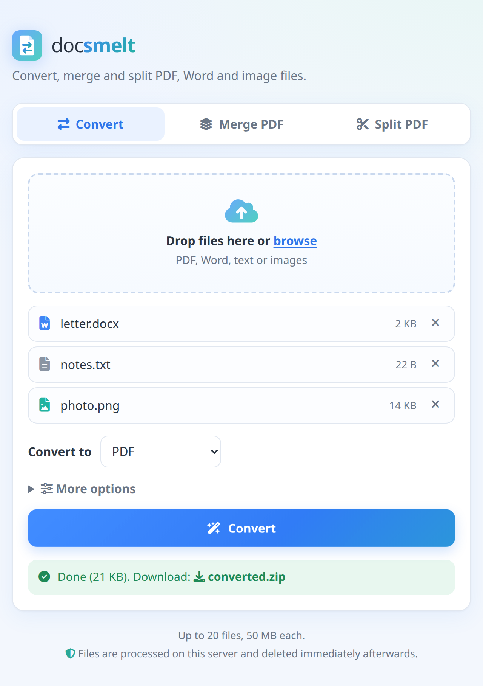
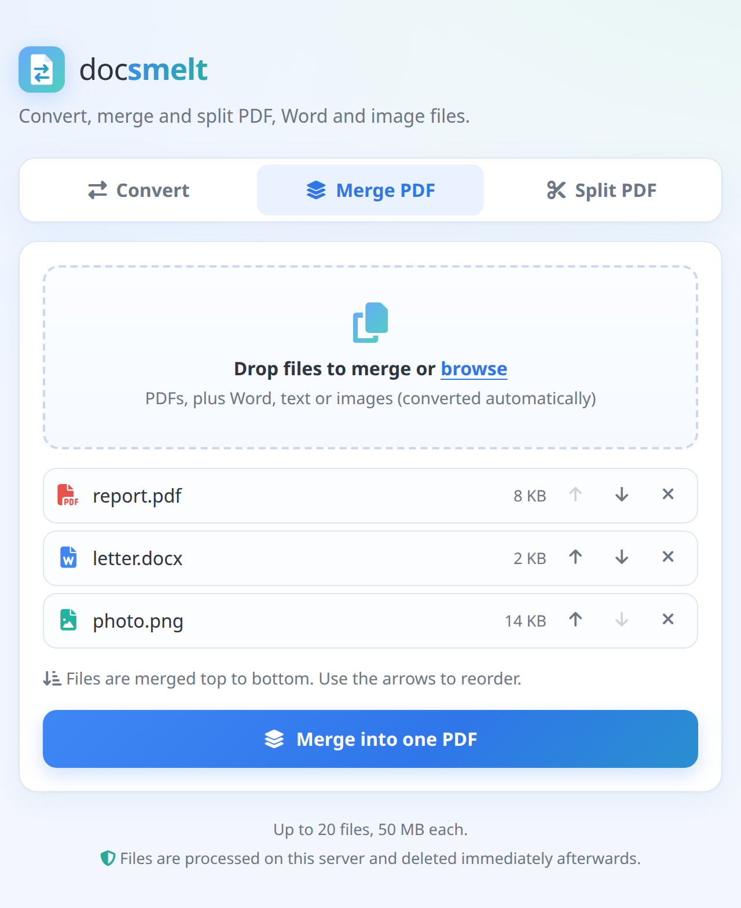
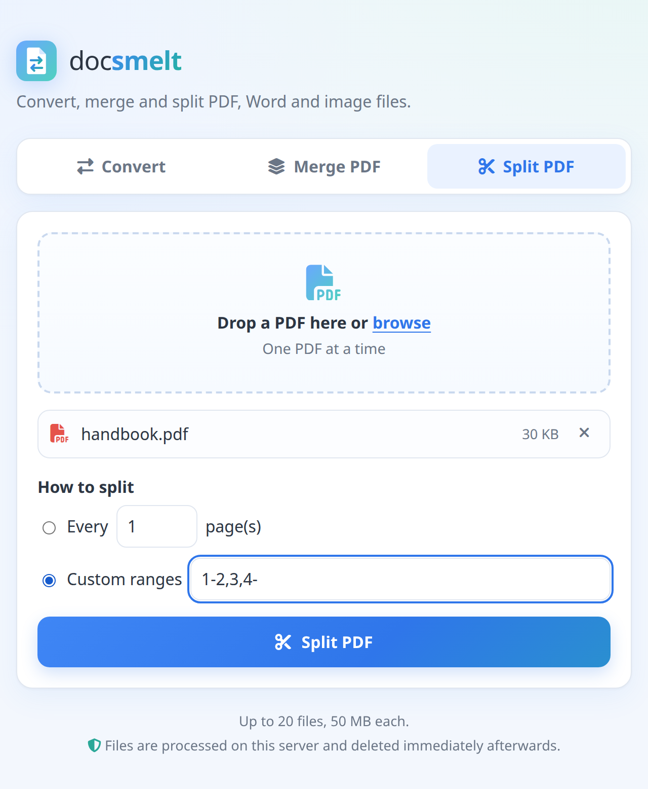
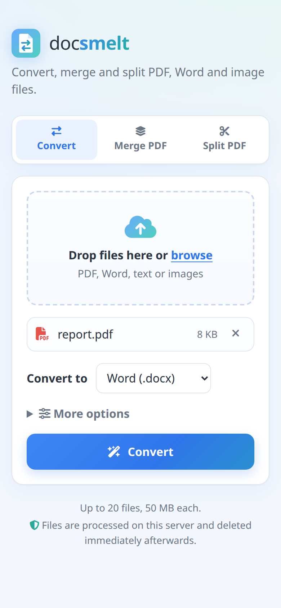

<p align="center">
  
</p>

<h1 align="center">DocSmelt</h1>

<p align="center">
  Convert, merge and split PDF, Word and image files, from a web page, the command line or Docker.<br>
  Object-oriented Java 21. Self-hosted: files never leave your server.
</p>

<p align="center">
  
</p>

## Features

- **Convert** between `pdf`, `docx`, `txt`, `png`, `jpg/jpeg`, `bmp` and `gif`, one file or whole folders
- **Merge** any mix of PDFs, Word files, text and images into one PDF
- **Split** a PDF every N pages or by custom ranges
- **Unicode PDFs**: Latin, Greek, Cyrillic built in; Chinese, Japanese, Korean via a fallback font
- **Web UI** with drag and drop, plus a REST API, a CLI and a Docker image

<table>
  <tr>
    <td align="center"><br><b>Merge</b>: reorder, then combine</td>
    <td align="center"><br><b>Split</b>: every N pages or ranges</td>
    <td align="center"><br><b>Mobile</b>-friendly</td>
  </tr>
</table>

## Usage

```bash
mvn package                                    # builds target/docsmelt.jar (runs tests)
alias docsmelt='java -jar target/docsmelt.jar'

# Convert
docsmelt report.docx report.pdf
docsmelt slides.pdf page.png --dpi 300          # multi-page → page-1.png, page-2.png, ...
docsmelt scan.pdf cover.jpg --pages 1 -q 80     # page selection, JPEG quality

# Batch (files and folders; folder inputs skip files of other types)
docsmelt --to pdf docs/ notes.txt -o out/ -r -j 4

# PDF tools
docsmelt merge cover.jpg report.docx appendix.pdf -o book.pdf   # non-PDFs converted automatically
docsmelt split book.pdf                         # one file per page
docsmelt split book.pdf --every 10 -o parts/
docsmelt split book.pdf --ranges 1-3,4-9,10-    # one file per range
docsmelt split book.pdf --ranges 5-7            # extract pages

docsmelt --help | docsmelt merge --help | docsmelt split --help
```

Exit codes: `0` ok, `1` conversion failed, `2` bad usage.

### Unicode / fonts

PDF output embeds DejaVu Sans (Latin, Greek, Cyrillic and many symbols). For
other scripts such as Chinese, Japanese or Korean, add a TrueType fallback font:

```bash
docsmelt notes.txt notes.pdf --font /usr/share/fonts/truetype/droid/DroidSansFallbackFull.ttf
# or once for all runs:
export DOCSMELT_FONTS=/path/a.ttf:/path/b.ttf
```

Only `.ttf` fonts with TrueType outlines work (PDFBox limitation; `.ttc`/CFF `.otf` don't).
Characters no font covers (e.g. colour emoji) become `?`.

## Web UI

```bash
docsmelt serve                    # http://127.0.0.1:8080 (this computer only)
docsmelt serve --host 0.0.0.0     # reachable from your network
```

A single page with Convert, Merge PDF and Split PDF tabs, drag and drop, and
upload progress. Icons come from Font Awesome, served from the jar (no CDN).
Uploads are processed in a private temp folder that is deleted as soon as the
response is sent.

Limits (all configurable on `serve`): `--max-upload-mb 50`, `--max-files 20`,
`--rate-limit 30` requests/minute per IP. Concurrent conversions are capped at
the number of CPU cores.

API (multipart/form-data, field `files`):

| Endpoint | Fields | Returns |
|---|---|---|
| `POST /api/convert` | `files` (1+), `to`, `pages?`, `dpi?`, `quality?` | the file, or a `.zip` if several |
| `POST /api/merge` | `files` (2+, in order) | `merged.pdf` |
| `POST /api/split` | `files` (1 PDF), `every?` or `ranges?` | a `.zip` of the parts |
| `GET /api/formats` | | formats and limits as JSON |

Errors are JSON: `{"error": "..."}` with status 400, 429 or 503.

## Docker

```bash
docker compose up -d             # web UI on http://localhost:8080
DOCSMELT_PORT=8090 docker compose up -d   # if 8080 is taken

# or the CLI, without the web UI:
docker build -t docsmelt .
docker run --rm -u "$(id -u):$(id -g)" -v "$PWD:/work" docsmelt report.docx report.pdf
docker run --rm -u "$(id -u):$(id -g)" -v "$PWD:/work" docsmelt merge a.pdf b.pdf -o all.pdf
```

The image runs the test suite during build and ships with a CJK fallback font
preconfigured. With no arguments it starts the web UI; any arguments run the
CLI instead (paths relative to the mounted `/work`).

## Design

```
Reader ──► Document (pages → blocks) ──► Writer
```

| Package | Role |
|---|---|
| `model` | Format-neutral `Document` → `Page` → `Block` (sealed: `Paragraph`, `ImageBlock`). A page may carry a raster *snapshot* of its original look. |
| `io` | `DocumentReader` / `DocumentWriter` strategy interfaces, `ReadOptions`, `WriteOptions`, `PageRange`. |
| `io.pdf`, `io.docx`, `io.image`, `io.text` | Adapters over Apache PDFBox, Apache POI and ImageIO. `FontChain` does per-character font fallback. |
| `core` | `FormatRegistry` (factory), `Converter` (single conversion), `ConversionOptions`. |
| `core.batch` | `JobPlanner` (expands folders), `BatchConverter` (parallel, failure-tolerant), `ConversionListener` (progress observer). |
| `pdf` | `PdfMerger`, `PdfSplitter`, `SplitStrategy` (sealed: `EveryNPages`, `ByRanges`). |
| `cli` | picocli commands: convert (default), `merge`, `split`. |

### Adding a format

1. Add it to `Format`.
2. Implement `DocumentReader` and/or `DocumentWriter`.
3. Register it in `FormatRegistry.withDefaults()`.

## Known limitations

- PDF → Word extracts text and images, not layout, fonts or exact positions.
- Word tables are flattened to `cell | cell` lines; EMF/WMF images are skipped.
- Word → image uses docsmelt's own simple layout, not Word's.
